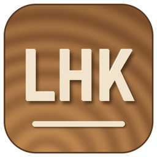

# LHK_Sculpt – Bild zu Relief (Rust)



**Land & Holzkommando JOL GbR**

Erzeugt aus einem Foto ein 3D-Relief (STL/OBJ) mit Bildverwaltung,
Analyse-Button, Reglern und 3D-Viewer. Läuft auf Windows (x86-64) und macOS
(Apple Silicon/ARM, Metal-Beschleunigung).

## Ablauf

1. **Bild laden** (JPEG über libjpeg-turbo, PNG/WebP/BMP/TIFF; Transparenz
   wird auf Weiß gelegt). Kleine Bilder (kurze Seite < 700 px) werden mit
   Real-ESRGAN x2 vergrößert.
2. **Tiefenschätzung** mit Depth Anything V2 Small (ViT-S).
3. **Objekterkennung** mit BiRefNet: Personen inkl. Haare, Brillen usw.
4. **Detailfoto**: Real-ESRGAN x2 für sauberere Feinstruktur.
5. **Objekt-Relief** (`src/objects.rs`): Jedes erkannte Objekt wird zu einem
   zusammenhängenden, gerundeten Körper auf einer eigenen Hintergrundebene.
   Der Hintergrund wird hinter den Objekten aufgefüllt. Feindetails
   (Haare, Falten, Steine, Blätter) kommen als kleine, helligkeitsunabhängige
   Höhen pro Objekt dazu, daher gibt es keine Krater durch dunkle Kleidung
   oder Schatten.
6. **Mesh** (`src/mesh.rs`): regelmäßiges Gitter mit kantenerhaltender
   Glättung, Detailschicht, Spike-Filter pro Objekt, Hintergrund-Schärfe,
   Seitenwände, flacher Boden.

## Regler

| Regler | Wirkung |
|---|---|
| Höhe | Reliefhöhe in Modell-Einheiten (Standardgröße ca. 700 breit) |
| Detail | Stärke der Feindetails |
| Glättung | glättet flache Bereiche, Umrisse bleiben scharf |
| Spike-Filter | drückt Ausreißer pro Objekt auf die passende Höhe herunter |
| Hintergrund-Schärfe | nur der Hintergrund: < 100 % glatter, > 100 % schärfer |
| Sockel | Dicke unter dem tiefsten Punkt (% der Reliefhöhe) |

Die Standardwerte wurden gegen Referenz-Reliefs abgestimmt.

**Export:** STL oder OBJ, wahlweise als geschlossener Körper (Wände und
Boden). Breite und Gesamthöhe sind frei wählbar; bei 0 wird die
Standardgröße (Fläche ca. 748 000 Einheiten²) verwendet bzw. die Höhe
proportional mitskaliert.

## Modelle

Alle Modelle erlauben kommerzielle Nutzung. Das fertige Windows-Paket unter
**Releases** enthält sie bereits (Ordner `models` neben der Exe): entpacken
und starten.

| Datei | Quelle | Lizenz |
|---|---|---|
| `depth_anything_v2_vits.pth` | Depth-Anything-V2-Small (Hugging Face: `depth-anything/Depth-Anything-V2-Small`) | Apache-2.0 |
| `birefnet/model.safetensors` | BiRefNet (Hugging Face: `ZhengPeng7/BiRefNet`) | MIT |
| `realesr-animevideov3-x2.bin` | Real-ESRGAN, ncnn-Modelle aus realesrgan-ncnn-vulkan | BSD-3-Clause |

Wer selbst baut, lädt sie mit `fetch_models.ps1` (Windows) bzw.
`./fetch_models.sh` (macOS) in den Ordner `models`.

Gesucht wird in dieser Reihenfolge: Umgebungsvariable `LHK_MODELS`, der
zuletzt gewählte Ordner, `models` neben dem Programm bzw. im App-Bundle.
Fehlen die Dateien, fragt das Programm nach dem Ordner.

Die Base/Large-Varianten von Depth Anything V2 sind nur nicht-kommerziell
lizenziert (CC-BY-NC-4.0) und werden nicht automatisch geladen.

## Bauen

**Windows:** `powershell -File build_windows.ps1` → `dist\LHK_Sculpt.exe`

**macOS (Apple Silicon):**
```
xcode-select --install          # einmalig
curl https://sh.rustup.rs -sSf | sh
./fetch_models.sh               # Modelle laden (ca. 520 MB)
./build_macos.sh                # → dist/LHK_Sculpt.app (mit Metal, inkl. Modelle)
```

## Bedienung

1. Links „Bilder hinzufügen“ oder Bilder ins Fenster ziehen
2. Qualität (750k / 1M / 1,5M / 2,5M Dreiecke) und Tiefen-Auflösung wählen
3. „Analyse starten“
4. Rechts die Regler einstellen; das Relief aktualisiert sich live
5. 3D-Ansicht: linke Maus drehen, rechte Maus verschieben, Mausrad zoomen,
   Doppelklick setzt die Ansicht zurück
6. „Export STL/OBJ“

## Kommandozeile (`lhk_cli`)

```
lhk_cli generate <bild> <ausgabeordner> [1024]
lhk_cli mesh <ausgabeordner> <relief.stl> height=20.98 detail=3.6 smooth=44 spike=75 bgsharp=49 base=0.15 tri=1500000
```

Lizenzhinweise zu den nachgebildeten Algorithmen: `THIRD_PARTY_NOTICES.md`.
